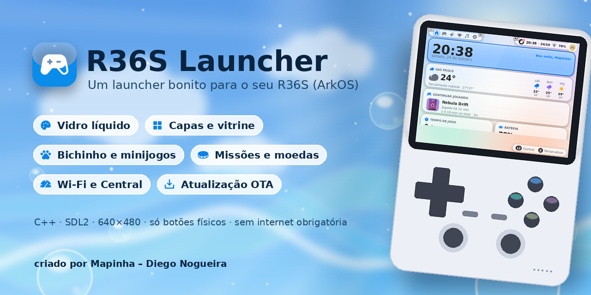
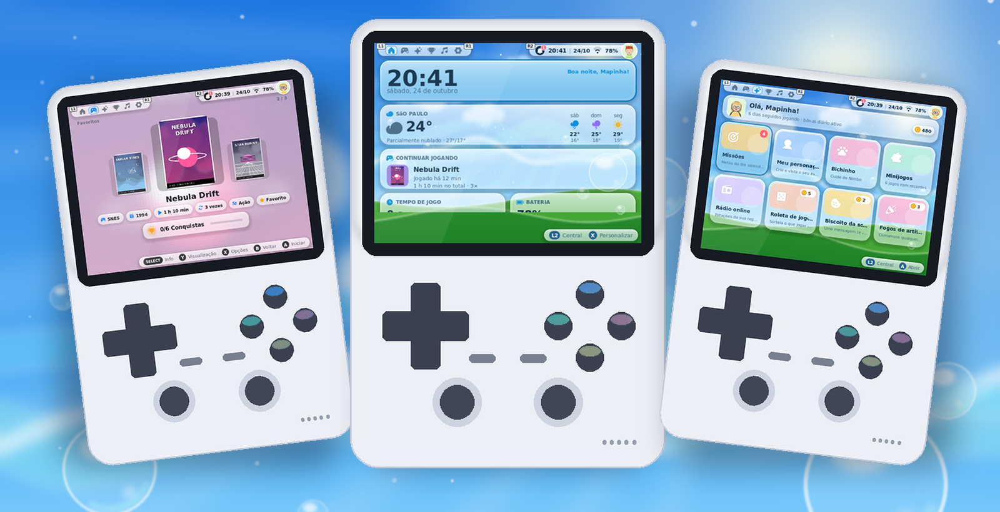
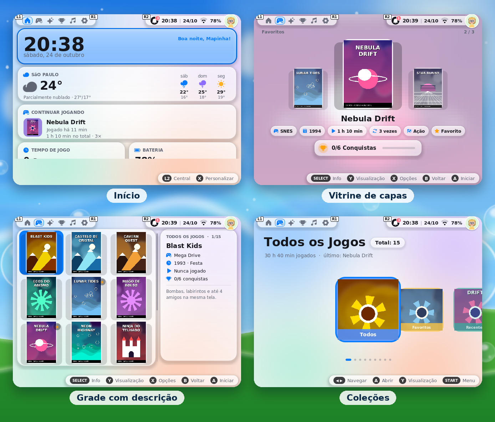
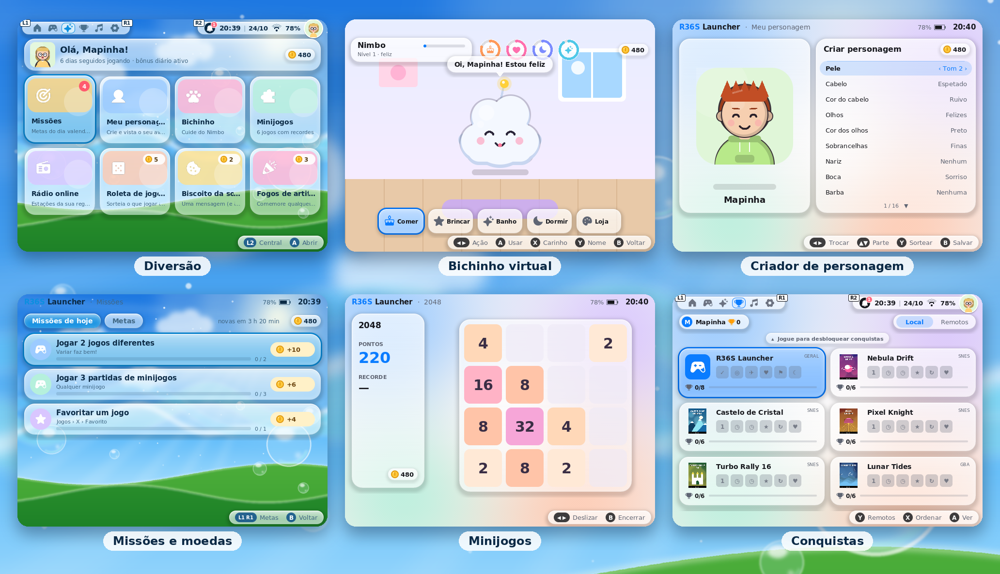
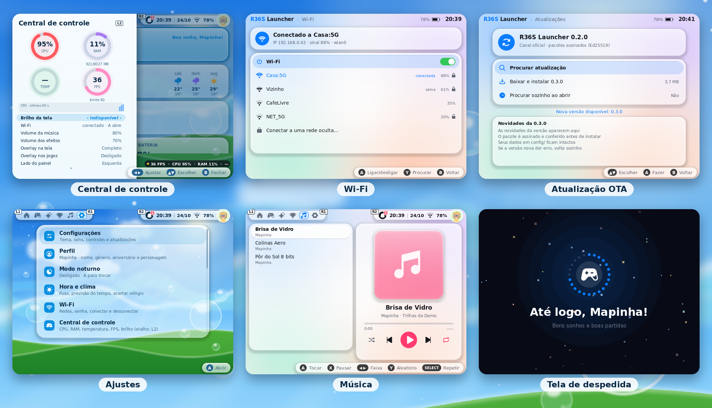
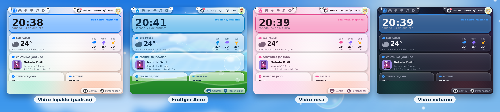

<p align="center">
  
</p>

<h1 align="center">R36S Launcher</h1>

<p align="center">
  <b>Um launcher moderno, leve e divertido para o portátil R36S com ArkOS.</b><br>
  Vidro líquido, vitrine de capas, bichinho virtual, minijogos, missões com moedas,
  Wi-Fi, central de controle e atualização pela internet. Tudo no controle, sem teclado nem mouse.
</p>

<p align="center">
  
  
  
  
  
</p>

<p align="center">
  <a href="#-instalação">Instalação</a> ·
  <a href="#-recursos">Recursos</a> ·
  <a href="#-controles">Controles</a> ·
  <a href="#-atualizações-ota">Atualizações</a> ·
  <a href="#-compilar">Compilar</a> ·
  <a href="docs/GUIA.md">Guia completo</a>
</p>

<p align="center">
  
</p>

---

## ✨ O que é

O **R36S Launcher** é um aplicativo que abre pelo menu **Tools** do ArkOS e transforma o R36S numa central de jogos
com cara de sistema novo. Ele usa **os mesmos emuladores e comandos que o EmulationStation já usa**, então não instala
nada duplicado e não mexe nas suas configurações. Ao sair, você volta para o EmulationStation como sempre.

- 🎮 **Feito para o controle.** Funciona só com os botões físicos, em 640×480, e tem assistente para mapear os botões.
- 🪶 **Leve.** É feito em C++ com SDL2, roda a 60 FPS e não lê o cartão enquanto desenha a tela.
- 🔒 **Respeita o seu sistema.** Não sobrescreve arquivos do ArkOS e não monta comandos de shell com o nome das ROMs.
  Tudo que é opcional pede confirmação.
- 📴 **Funciona sem internet.** Clima, rádio, capas e atualizações são extras que só usam a rede quando você pede.

## 📸 Telas

### Jogos

<p align="center"></p>

### Diversão

<p align="center"></p>

### Sistema

<p align="center"></p>

### Temas

<p align="center"></p>

> As capturas usam uma biblioteca de demonstração com jogos fictícios e capas geradas pelo próprio projeto
> (`scripts/make-demo.py`).

## 🚀 Recursos

<table>
<tr>
<td width="50%" valign="top">

**🏠 Início**
- Relógio, saudação, clima da sua cidade e previsão
- "Continuar jogando", tempo de jogo, bateria e conquistas
- Painel personalizável (X)

**🎮 Jogos**
- Detecta a biblioteca da EASYROMS sozinho
- Carrossel, vitrine de capas (coverflow), grade e lista (Y troca)
- Descrição, ano, gênero, tempo jogado e favoritos
- Recentes, Favoritos e coleções automáticas
- Abre o jogo com o emulador e o core padrão do ArkOS

**🖼️ Capas e arte (fontes livres)**
- Baixa as capas de todos os jogos (libretro-thumbnails)
- Busca a capa de um jogo pelo nome, com prévia
- Ícones dos sistemas (RetroArch assets, CC BY 4.0)
- Importa as suas próprias imagens da pasta `capas`

</td>
<td width="50%" valign="top">

**🐾 Diversão**
- **Nimbo**, um bichinho virtual: dar comida, brincar, dar banho, pôr para dormir e comprar coisas na loja
- **Criador de personagem** com 16 partes e acessórios
- **Missões do dia** e metas que dão **moedas**
- 6 **minijogos**: Cobrinha, Memória, 2048, Genius, Pong e Toupeira
- Rádio online da sua região, roleta de jogos, biscoito da sorte e fogos

**⚙️ Sistema**
- **Central de controle** (L2): anéis de CPU, RAM, temperatura e FPS, brilho, volumes e overlay
- **Wi-Fi**: ver as redes, conectar com senha, esquecer rede, rede oculta
- **Atualização OTA** assinada, que volta sozinha se der erro
- Desligar ou reiniciar sem passar pelo EmulationStation
- Opção de ligar o console direto no launcher (opcional)
- Música de fundo original, sons da interface, modo noturno e notificações

</td>
</tr>
</table>

**Temas:** Vidro líquido (padrão), Frutiger Aero, Vidro rosa, Vidro noturno, Meia-noite e Fliperama. Na configuração
inicial você escolhe nome, aniversário e tema, e pode mudar tudo depois.

## 📦 Instalação

1. Baixe o **`R36SLauncher-R36S-pronto.zip`** na página de [Releases](../../releases).
2. Com o cartão no computador, abra a partição **EASYROMS** e copie a pasta `tools/` do zip para dentro dela,
   juntando com a pasta `tools/` que já existe:
   ```
   EASYROMS/
   └── tools/
       ├── R36SLauncher/                 o aplicativo (executável, scripts e data/)
       ├── R36S Launcher.sh              aparece no menu Tools
       └── R36S Launcher - Controles.sh  teste e mapeamento dos botões
   ```
3. No console, abra **Tools → R36S Launcher**. A configuração inicial leva menos de um minuto.

> 💡 Quer que o console já ligue no launcher? Use **Ajustes › Iniciar direto no launcher**. Essa opção pede confirmação
> dupla e pode ser desfeita. Se precisar voltar ao normal sem o launcher, crie um arquivo `NAO_INICIAR_LAUNCHER` na
> pasta `R36SLauncher`.

**Requisitos:** R36S (ou um clone com RK3326) com **ArkOS**. Vem compilado para aarch64, glibc 2.27 e SDL 2.0.10 ou mais
nova. Não precisa instalar nada no sistema.

## 🎮 Controles

| Botão | Função |
|---|---|
| Direcional / analógico | Navegar |
| **A** | Confirmar / jogar |
| **B** | Voltar |
| **X** | Opções do jogo (favoritar, escolher capa…) |
| **Y** | Trocar a visualização dos jogos |
| **L1 / R1** | Trocar de seção (Início, Jogos, Diversão, Conquistas, Música, Ajustes) |
| **L2** | Central de controle |
| **R2** | Notificações |
| **START** | Menu |
| **SELECT** | Informações do jogo |
| **START + SELECT** (1,5 s) | Sair na hora |

Se algum botão não responder, o launcher avisa e oferece o mapeamento na hora. Também dá para trocar A e B em
Configurações.

## 🔄 Atualizações (OTA)

Em **Ajustes › Configurações › Atualizações** você procura, baixa e instala versões novas pela internet.

- **Pacotes assinados (Ed25519):** o console só aceita atualizações assinadas com a chave do autor.
- **Arquivo conferido (SHA-512):** pacotes com links, caminhos estranhos ou arquivos em `config/` são recusados.
- **Seus dados ficam:** perfil, moedas, bichinho, capas escolhidas e ajustes (`config/`) nunca são tocados.
- **Volta sozinho:** se a versão nova fechar com erro logo ao abrir, o launcher volta para a anterior. Também dá para
  voltar manualmente.
- **Bateria baixa:** com menos de 20%, o download é bloqueado.

Quem publica usa `scripts/ota.py` (empacotar e assinar). O passo a passo está no [guia completo](docs/GUIA.md#atualizações-pela-internet-ota).

## 🛠️ Compilar

```bash
# PC (Linux) — para testar com teclado
sudo apt install build-essential cmake pkg-config libsdl2-dev libsdl2-ttf-dev
cmake -S . -B build && cmake --build build -j
./build/r36s-launcher --windowed

# R36S (aarch64) — cross-compilação com zig, gera dist-r36s/tools/
bash scripts/build-r36s-zig.sh
```

No PC: setas para navegar, Enter = A, Backspace = B, S = X, A = Y, Q/W = L1/R1, PageUp/PageDown = L2/R2,
Espaço = START e Tab = SELECT. Os testes automáticos e as opções de linha de comando estão no [guia completo](docs/GUIA.md).

## 📁 Estrutura

```
src/
├── core/        app, laço principal, utilitários (JSON, arquivos, log)
├── ui/          telas: início, jogos, diversão, bichinho, minijogos, central, Wi-Fi…
├── library/     leitura da EASYROMS, gamelist, capas
├── emulator/    abre os jogos com o comando do EmulationStation (sem shell com nome de ROM)
├── net/         HTTP via curl, clima, rádio, Wi-Fi (nmcli)
├── update/      OTA: assinatura, SHA-512, extração validada
├── profile/     perfil, missões, moedas, bichinho
├── music/       player, música de fundo e efeitos sintetizados
└── system/      bateria, brilho, desempenho, inicialização automática
data/            fontes, temas, ícones, música e papéis de parede
scripts/         build, launch.sh, OTA, geração de imagens e demo
docs/            guia completo e imagens
```

## 🙌 Créditos

Criado por **Mapinha – Diego Nogueira**.

Este projeto usa:
- [SDL2](https://libsdl.org) e [SDL_ttf](https://github.com/libsdl-org/SDL_ttf) (zlib)
- [FreeType](https://freetype.org)
- [DejaVu Sans](https://dejavu-fonts.github.io), a fonte (licença livre)
- [Phosphor Icons](https://phosphoricons.com), os ícones (MIT)
- [Monocypher](https://monocypher.org), para a assinatura das atualizações (BSD-2 / CC0)
- [stb_image / stb_vorbis](https://github.com/nothings/stb) e [dr_libs](https://github.com/mackron/dr_libs) (domínio público / MIT)
- Dados e serviços gratuitos: [libretro-thumbnails](https://github.com/libretro-thumbnails/libretro-thumbnails),
  [RetroArch assets](https://github.com/libretro/retroarch-assets) (CC BY 4.0), [Open-Meteo](https://open-meteo.com),
  [ip-api](https://ip-api.com), [Radio Browser](https://www.radio-browser.info) e a Wikipédia

A música de fundo "Vidro Líquido", o papel de parede Frutiger Aero e as capas da demonstração foram feitos pelo
próprio projeto e são livres de direitos.

> R36S, ArkOS, EmulationStation e RetroArch pertencem aos seus respectivos donos. Este é um projeto independente e
> sem vínculo com eles. O launcher não vem com jogos nem BIOS: use só cópias que você tem o direito de usar.

## 📄 Licença

<!-- Escolha a licença do projeto (por exemplo MIT ou GPL-3.0), adicione o arquivo LICENSE e atualize esta seção. -->
A licença ainda vai ser definida pelo autor. As bibliotecas de terceiros mantêm as próprias licenças (veja os
arquivos `LICENSE*` em `data/` e `third_party/`).

---

<p align="center">Feito com 💙 para quem ama jogar no bolso.</p>
